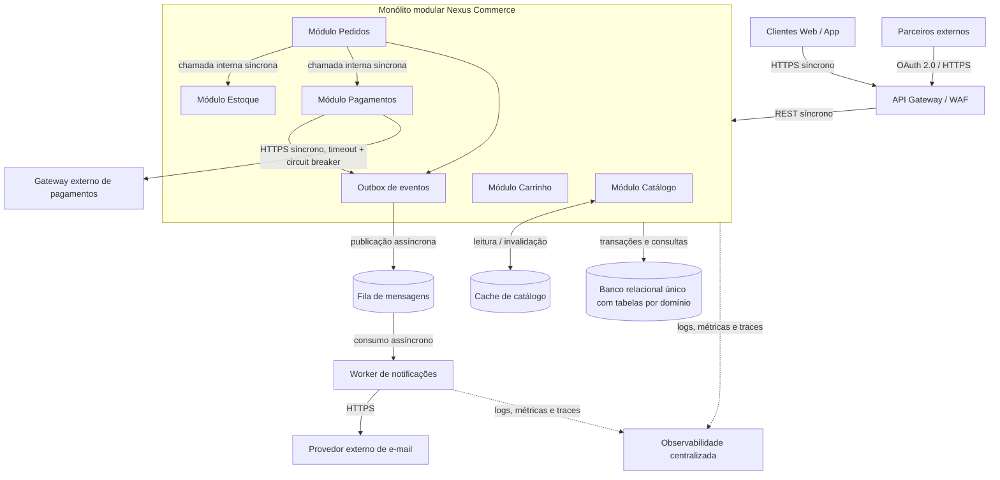

# cp6-soa# CP6 — Arquitetura Orientada a Serviços

## Nexus Commerce — Black Friday sob pressão

**Disciplina:** Arquitetura Orientada a Serviços  
**Turma:** 3ESPY — FIAP  
**Integrantes:**

| Nome | RM |
|---|---|
| Henrique Borges de Castro Sanches | 557959 |

## 1. Contexto e diagnóstico arquitetural

A Nexus Commerce processa aproximadamente 50 mil pedidos por dia e espera atingir 500 mil na Black Friday, além de picos de 10 mil usuários simultâneos. Seu monólito compartilha banco de dados entre catálogo, carrinho, pedidos, estoque, pagamentos e notificações. Integrações síncronas e acoplamento elevam o risco de falhas em cascata.

| Problema e sintoma | Causa arquitetural provável | Impacto para o negócio | Prioridade e justificativa |
|---|---|---|---|
| Lentidão geral quando o catálogo recebe tráfego | Módulos compartilham recursos computacionais e banco; falta isolamento de carga | Pedidos e pagamentos ficam lentos, com perda de conversão | **Alta:** o tráfego esperado é 10 vezes maior |
| Timeouts no pagamento, alguns acima de 30 s | Dependência síncrona de gateway instável e falta de tratamento de estado incerto | Carrinhos abandonados e compras sem confirmação | **Crítica:** afeta diretamente receita e confiança |
| Pedidos ou cobranças duplicadas após novas tentativas | Ausência de chave de idempotência e tratamento inadequado de retries | Cobranças indevidas, estornos e reclamações | **Crítica:** prejuízo financeiro direto |
| Venda simultânea da última unidade | Concorrência sem atualização atômica ou bloqueio adequado no estoque | Overselling, cancelamentos e insatisfação | **Crítica:** compromete a disponibilidade real |
| Falha na compra quando e-mail está indisponível | Notificação síncrona e obrigatória no fluxo transacional | Pedidos válidos deixam de ser concluídos | **Alta:** falha não essencial derruba venda |
| Dificuldade para rastrear uma compra | Logs isolados e ausência de identificadores correlacionados | Diagnóstico lento e incidentes prolongados | **Alta:** dificulta resposta durante o pico |
| Acesso pouco restrito a APIs internas | Autenticação e autorização insuficientes | Fraude, vazamento de dados e uso indevido | **Alta:** risco de segurança |
| Integração insegura com parceiros | Falta de fronteira de API pública | Exposição indevida de recursos internos | **Média:** importante para expansão, após estabilização |

**Distinção entre sintomas e causas:** lentidão, timeout, duplicação e indisponibilidade são sintomas observados; as causas prováveis são acoplamento, chamadas síncronas, falta de idempotência, contenção de recursos e controle de concorrência inadequado.

## 2. Proposta de arquitetura e System Design

**Escolha:** modernizar gradualmente o sistema para um **monólito modular**, isolando responsabilidades por domínio, mantendo inicialmente o banco relacional existente e introduzindo uma fila para tarefas assíncronas. Usar **API Gateway** como entrada controlada e **cache** para leituras de catálogo. Isso preserva a operação, exige menos esforço de uma equipe limitada e evita a migração completa para microsserviços em 60 dias.

### Responsabilidades e comunicação

- **API Gateway / WAF:** entrada para clientes e parceiros; validação de tokens, rate limiting, roteamento e proteção da superfície pública.
- **Catálogo + cache:** disponibiliza produtos e preços com respostas rápidas; invalidação do cache quando dados mudam, com preço e disponibilidade confirmados antes da compra.
- **Carrinho:** organiza itens e quantidades antes do checkout.
- **Pedidos:** registra pedidos e coordena seu estado (criado, aguardando pagamento, pago, cancelado).
- **Estoque:** gerencia quantidade e reservas com operações atômicas no banco.
- **Pagamentos:** comunica-se com o provedor e reconcilia resultados incertos.
- **Outbox + fila:** grava evento de negócio junto à transação e o publica posteriormente, evitando perder eventos em falhas intermediárias.
- **Worker de notificações:** envia e-mails fora do caminho crítico do checkout.
- **Banco relacional:** mantém inicialmente um banco único, com fronteiras lógicas de tabelas por módulo, restrições de unicidade e transações ACID em reservas e pedidos.
- **Observabilidade:** coleta logs estruturados, métricas e rastreamento distribuído.

**Integrações síncronas:** cliente → gateway → monólito; reserva de estoque e persistência; serviço de pagamentos → gateway externo. **Integrações assíncronas:** eventos de pedido/pagamento → fila → notificações. O sistema não exige confirmação de e-mail para concluir a compra.

A evolução pode ser feita por etapas e com feature flags, sem substituição integral do sistema. Primeiro instrumentam-se os fluxos existentes; depois adicionam-se idempotência e controle de estoque; por fim desacoplam-se notificações e otimizam-se consultas de catálogo.

## 3. Resiliência e consistência

### 3.1 Pagamento com timeout e cliente tentando novamente

O checkout recebe uma **chave de idempotência única por tentativa lógica de compra**, associada ao pedido e ao cliente. No banco, uma restrição de unicidade impede gerar outra cobrança para a mesma operação. Ao chamar o provedor, o sistema reutiliza a chave de idempotência do pagamento, se a API dele oferecer esse recurso.

Se ocorrer timeout, o pagamento passa para o estado **PENDENTE_DE_CONFIRMACAO**: não se presume nem sucesso nem falha. O sistema consulta a transação pelo identificador no gateway e utiliza webhook autenticado e reconciliação para obter o resultado final. Se o usuário clicar novamente, recebe o estado do mesmo pedido, sem disparar nova cobrança; só há uma nova tentativa financeira quando a tentativa anterior estiver comprovadamente encerrada de modo seguro. Aplicam-se timeout, retries limitados com backoff para operações seguras/idempotentes e circuit breaker quando o gateway fica instável.

**Resultado esperado:** mesmo com atrasos, o usuário não é cobrado duas vezes pela mesma tentativa de compra, e a confirmação é atualizada assim que o resultado fica conhecido. Se houver falha definitiva, a reserva de estoque é liberada.

### 3.2 Dois clientes tentando comprar a última unidade

A reserva usa transação no banco com atualização condicional atômica, por exemplo: `UPDATE estoque SET disponivel = disponivel - 1 WHERE produto_id = ? AND disponivel >= 1`. A compra avança apenas se uma linha foi atualizada; a reserva é registrada na mesma transação. Uma reserva possui validade para evitar estoque preso por pagamento abandonado.

**Resultado esperado:** o primeiro cliente reserva a última unidade; o segundo recebe mensagem de indisponibilidade, sem pedido confirmado. Se o pagamento do primeiro falhar ou expirar, a reserva é liberada de forma idempotente, com controle de estado para evitar liberação dupla.

### 3.3 Provedor de e-mail indisponível

Após a criação/confirmação do pedido, o sistema grava o evento em uma tabela **outbox**, na mesma transação de banco. Um publicador envia esse evento para uma fila e o worker tenta disparar o e-mail sem bloquear o checkout. Em falhas do provedor, faz retries limitados com backoff e encaminha mensagens irrecuperáveis para uma **fila de mensagens mortas (DLQ)** para análise. Consumidores são idempotentes.

**Resultado esperado:** o pedido válido é concluído mesmo quando o e-mail não é enviado imediatamente; o aviso é entregue posteriormente ou fica disponível para tratamento. O status também pode ser consultado na conta do cliente.

## 4. Segurança e integração entre sistemas

**Autenticação** verifica **quem** é o usuário ou aplicação. **Autorização** determina **o que** esse usuário ou aplicação pode acessar.

| Superfície | Mecanismos propostos | Controle de acesso |
|---|---|---|
| APIs de clientes | Login via OpenID Connect (OIDC); access token JWT de curta duração validado pelo gateway/API; HTTPS; rate limiting | Cada usuário acessa somente os próprios carrinhos e pedidos; validação de propriedade do recurso no backend |
| Operações administrativas | OIDC corporativo, MFA, sessões curtas e trilha de auditoria | RBAC por papéis (suporte, estoque, financeiro, administrador) e princípio do menor privilégio |
| APIs de parceiros | OAuth 2.0 Client Credentials para integração máquina-a-máquina; tokens com escopos, validade e público (`aud`) controlados; quotas | Rotas e permissões específicas por parceiro, acesso apenas a dados autorizados e isolamento por `partnerId` |

**JWT** é um possível formato de token assinado, não substitui OAuth 2.0 nem define permissões por si só. **OAuth 2.0** disciplina a autorização delegada/acesso de aplicações. **OpenID Connect** acrescenta identidade/autenticação do usuário ao fluxo OAuth 2.0.

As APIs públicas dos parceiros são disponibilizadas somente por rotas de gateway dedicadas e versionadas, nunca por conexão direta ao banco ou endpoints internos. O backend valida escopos, titularidade, dados enviados e autorização de cada operação; utiliza HTTPS, logs de auditoria, proteção contra abuso e segregação de credenciais. Segredos ficam em gerenciador de segredos, não em código-fonte.

## 5. Observabilidade, trade-offs e priorização

### 5.1 Acompanhamento da compra

1. O gateway cria ou propaga um `correlationId`/`traceId`, devolvido também à aplicação cliente quando apropriado.
2. O módulo de pedidos registra `pedido_criado` com identificador do pedido, horário e status.
3. O módulo de estoque registra `reserva_solicitada`, `reserva_confirmada` ou `reserva_negada`.
4. O módulo de pagamentos registra `pagamento_iniciado`, `pagamento_pendente`, `pagamento_confirmado` ou `pagamento_falhou`, inclusive tempo da chamada externa.
5. O evento `pedido_confirmado` é colocado na outbox/fila e a notificação é registrada separadamente.
6. Logs estruturados de todos os módulos incluem `correlationId`, `orderId`, componente, operação, duração, status e erros. Não registrar números completos de cartão, credenciais, tokens ou dados pessoais desnecessários.

**Indicadores monitorados:** latência p50/p95/p99 do checkout, taxa de erros HTTP 5xx e timeouts, taxa de confirmação de pagamentos, número de pagamentos em estado desconhecido, tentativas duplicadas bloqueadas, reservas recusadas, utilização e lentidão do banco, atraso/tamanho da fila e taxa de falhas de e-mail. Alertas são configurados para anomalias e aumento sustentado de erros. Dashboards acompanham a compra de ponta a ponta.

### 5.2 Três decisões arquiteturais e seus trade-offs

| Decisão | Benefício esperado | Custo/desvantagem | Risco ou limitação assumida |
|---|---|---|---|
| Evoluir para monólito modular, sem migração total para microsserviços | Entrega mais rápida, menos infraestrutura e possibilidade de aproveitar transações existentes | Os módulos ainda compartilham processo e parte dos recursos | Falhas e picos podem afetar módulos vizinhos; isolamento será parcial |
| Introduzir outbox + fila para notificações | Checkout independente do e-mail e melhor tolerância a falhas | Exige worker, fila, monitoramento e tratamento de repetição | Entrega eventual e possível atraso de notificações |
| Adotar idempotência e reserva transacional de estoque | Reduz duplicações financeiras e overselling | Maior complexidade de estados, chaves e conciliação | Depende da integração correta com gateway e pode causar contenção em itens muito disputados |

### 5.3 Três melhorias prioritárias para os próximos 60 dias

**1. Pagamento seguro e idempotente (dias 1–20).** Implementar chave de idempotência, unicidade de transações, estado pendente, consulta de status, webhook validado, retries seguros e circuit breaker. **Por quê:** minimiza duplicidade de cobranças e perda de receita, um risco crítico com impacto direto no cliente.

**2. Reserva atômica de estoque (dias 15–35).** Ajustar o fluxo de checkout para reservar de forma transacional, com validade e compensação em cancelamento/expiração. **Por quê:** impede vender a mesma última unidade e pode ser implementado dentro do banco atual, sem migração.

**3. Desacoplamento de notificações e visibilidade do checkout (dias 30–60).** Introduzir outbox/fila para e-mails e instrumentar os passos críticos com `correlationId`, métricas e alertas. **Por quê:** remove uma dependência que hoje derruba pedidos e permite identificar gargalos antes e durante a Black Friday.

**Ações complementares de baixo esforço durante o período:** ativar limites de taxa e regras básicas de autenticação/autorização no gateway já existente ou adotado, adicionar cache para leituras de catálogo com invalidação e testar carga progressivamente. São medidas importantes, porém não substituem as três frentes principais. A equipe deve validar prioridades com testes de carga e monitoramento, sem assumir que a arquitetura suportará automaticamente 500 mil pedidos por dia.

### 5.4 Implantação sem interrupção

As mudanças são liberadas incrementalmente, com migrações de banco compatíveis com a versão anterior, feature flags, canário e rollback. O fluxo antigo continua disponível durante a transição. Antes da Black Friday, executar testes de concorrência (última unidade), retries/timeout (pagamento), indisponibilidade de e-mail e carga progressiva; avaliar resultados pelos indicadores de observabilidade.

---

**Conclusão:** a solução prioriza confiabilidade financeira, consistência do estoque e continuidade do checkout, com evolução incremental adequada ao prazo de 60 dias e à equipe limitada. A escolha consciente de um monólito modular mantém a complexidade operacional controlada sem impedir uma futura extração de serviços caso métricas comprovem essa necessidade.
